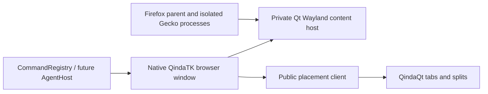

# Native controls, Gecko content, desktop layout

One stable browser view owns one QindaTK AppWindow. QindaQt owns container tab
pages, recursive split trees, decorations, geometry and interactive placement.

The initial backend starts installed Firefox/QindaFox with a **QindaWeb-owned**
profile. Gecko supplies real Wayland buffers on a private display. Qt
ShellSurfaceItem paints them, forwarding input and engine popups. The desktop
sees only Qt toplevels. This does not embed libxul or port Mozilla's widgets.

An internal WebDriver BiDi connection controls navigation and context creation.
It uses the ephemeral loopback endpoint printed by our own Firefox child, with
no system/chrome-script access. A short-lived page-title nonce pairs each exact
owned context to its private Wayland surface, including racing web popups; arrival
order is never identity. Session capabilities verify the engine identity;
certificate verification remains enabled. No sandbox, site-isolation or
accessibility disable flag is introduced. Automation's recommended testing
preferences are disabled. This is an experimental browser host, not a claim of
a stable desktop Gecko embedding SDK or completed production qualification.

QtMozEmbed/EmbedLite remains a possible later direct backend. The current Qt 5
port requires a Qt 6 render/input port, restored sandboxing and accessibility.
Do not ship a disabled-sandbox runtime or label QtWebEngine as Gecko.

Qt/QML/model/Wayland objects stay on the GUI thread. Firefox owns its child
processes; BrowserController owns native windows and stable view IDs. Callbacks
use weak view references. BiDi requests finish once on response, deadline or
disconnect. Runtime shutdown only targets the QProcess started here.

Context/window creation is serialized, pairing each BiDi window response to an
internal Gecko toplevel. Web-created top-level contexts become native Qt windows;
subframes never do. Engine context closure closes the matching native window.
Internal fullscreen removes GTK decorations on the private display, while the
outer Qt windows stay ordinary. Modal engine prompts still require qualification.
App IDs/PIDs never prove foreign-surface ownership.

Shortcuts, toolbar and menus share CommandRegistry. Ctrl+T creates a page and
submits Tab relative to its source. Ctrl+Alt+T creates a page then asks for a side
(arrow keys or native buttons); Escape keeps it separate. Ctrl+N opens an
independent window. Ctrl+Shift+T is reserved for eventual reopen. An absent or
refusing WM keeps the new window and reports the result.

The split candidate is initially unmapped and its Gecko context starts only after
placement confirmation or cancellation. This leaves keyboard focus with the source
picker. Confirmation maps the Qt window and submits its owned surface to the SDK;
cancellation maps it as an ordinary separate window. Closing a source releases its
candidate as an ordinary window rather than leaving an invisible view behind.

Ctrl+Shift+H hides the local menu, navigation and status bands without changing
command state. Ctrl+L reveals a temporary address field. Exported File/Navigate/View
commands and their checked/enabled state remain available while controls are hidden.
Automatic local-menu suppression requires a complete validated menu publication and
successful native announcement on the requesting Qt connection. Explicit user hiding
is independent of that detection. Each native window owns and withdraws its endpoint.

Theme publication consumes live, scoped Settings1 snapshots through the public
desktop client. Exact selected theme IDs resolve through ordered user/system catalogs;
invalid themes retain the last complete publication. Launch IPC is a separate bounded
same-session D-Bus endpoint elected by the owned-profile lock, not an agent interface.

The local side picker is a V1 compatibility UI. Replace it with the compositor's
shared preview/confirm/cancel selector when that public contract lands. The
browser never creates another container layout or resizes grouped window geometry.

The toolkit AgentHost adapter will expose live browser-domain state and typed
commands. Engine transport stays private; no second external agent protocol.
Content accessibility relationships, IME, clipboard/drag-and-drop, popups,
scaling, prompts, persistence and crash recovery need direct native evidence
before declaring desktop integration complete.

Sources: [Qt buffer and input hosting](https://doc.qt.io/qt-6/qwaylandquickitem.html),
[Firefox BiDi connection](https://developer.mozilla.org/en-US/docs/Web/WebDriver/How_to/Create_BiDi_connection),
[Mozilla remote preferences](https://firefox-source-docs.mozilla.org/remote/Prefs.html),
[QtMozEmbed ESR153 work](https://github.com/sailfishos/qtmozembed/pull/67).
